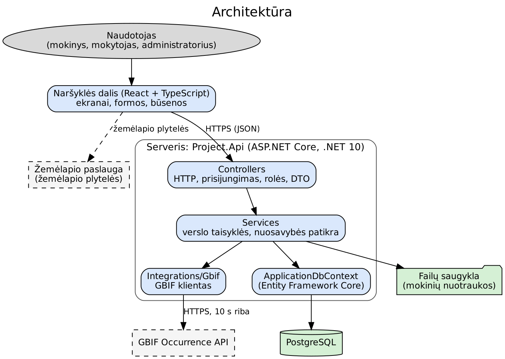

# Independent Work 3 – Software Architecture and AI Development Specification

## Objective

Define how the application will technically be built and establish a structured Spec-Driven Development workflow for working with AI coding assistants. The project uses Spec Kit. The constitution is created once for the whole project; individual features then follow their own specification and implementation cycle.

## 1. Select and Document the Technology Stack

The backend MUST use the **latest stable version of .NET and ASP.NET Core available when the project is initialized**.

Select and document the frontend framework or technology, database, ORM/data-access approach, testing frameworks, important libraries, and external services.

Every major dependency must have a clear reason for being included. Do not add a library only because an AI assistant suggested it.

**Example:** Frontend: React because the student needs a component-based SPA. Data access: Entity Framework Core because the project uses a relational database and needs migrations.

**Technologies**

- **Server:** .NET 10 and ASP.NET Core Web API. This is the latest stable version at the start of the project, as required by the assignment and the general rules.

- **Frontend:** React with TypeScript, Vite and React Router. React – screens are built from reusable parts; TypeScript – errors in API data types are visible already during development; Vite – build tool and development server; React Router – screen addresses.

- **Map:** Leaflet with OpenStreetMap tiles. Used only to choose a location (FR-025); the OpenStreetMap attribution link is shown. The location can also be given by coordinates.

- **Database:** PostgreSQL 17. The data are related to each other, and the email, username and class code must not repeat (VT-001, VT-002, VT-023).

- **Data access:** Entity Framework Core with Npgsql. Tables are created and changed by migrations. Services use ApplicationDbContext directly, without Repository or UnitOfWork (general rules).

- **DTO mapping:** AutoMapper. Entities are not returned from the API, and request and response DTOs are mapped by profiles (general rules).

- **Login and roles:** ASP.NET Core Identity. Passwords are stored only as values of a slow salted hash function; they are not encrypted and not stored in plain text (NFR-001). The session is a cookie with a 30-minute inactivity limit (NFR-004) and CSRF protection.

- **GBIF client:** HttpClient obtained through IHttpClientFactory, with a 10-second timeout (NFR-020). No additional libraries are included.

- **Photos:** SixLabors.ImageSharp. The library checks the real format (VT-030) and re-encodes the image without metadata (NFR-006). Files are stored in the server file storage, and the path is given in the configuration.

- **Tests:** xUnit for unit tests. For integration tests – xUnit with WebApplicationFactory and PostgreSQL through Testcontainers, so that the tests use a real database. In the tests GBIF is replaced by a fake HTTP response handler, so they do not depend on the internet. For the frontend – Vitest and React Testing Library.

- **Code quality:** .editorconfig and dotnet format (C#); ESLint and Prettier (frontend).

- **Running and checks:** docker-compose.yml for a local PostgreSQL; GitHub Actions for every pull request to main (NFR-026).

- **External services:** GBIF Occurrence API (mandatory) and OpenStreetMap map tiles. There are no other external services.

## 2. Define the Application Architecture

Create an architecture diagram showing at least the user, frontend, backend/API, and database. Add external services if the project uses them.

Define the responsibilities of the frontend, API layer, business/application logic, data access/infrastructure, and database. Business rules must not be hidden inside UI components or database-specific code.

**Example:** A simple diagram may be “User → Frontend → ASP.NET Core API → Application Services → Database”, with an external email service connected to the backend.

**Diagram:** User → Frontend → Controllers → Services → ApplicationDbContext (EF Core) → PostgreSQL. Services also call the GBIF Occurrence API and the file storage, and the browser gets map tiles from the map service.

**Responsibility of each part**

- **Frontend (React):** shows screens, forms and buttons, sends requests to the API, shows loading, empty and error states (NFR-028, NFR-029). There are no game rules here. Field checking here is only for convenience; the server checks everything again.

- **Controllers:** receive HTTP requests, check login and role (NFR-003), accept the request DTO, call a service and return the response DTO. There are no business rules or database queries here.

- **Services:** all business rules and the ownership check are here (for example, whether a class belongs to the teacher). Examples: observation selection and seasons (VT-011, VT-012), task creation from observations (VT-013), points (VT-016), best result (VT-017), group unlocking (VT-014), class average (VT-028), matching a teacher-task answer (VT-018), hiding the coordinates of a protected species (VT-020).

- **Integrations/Gbif:** the only place that calls the GBIF Occurrence API. Services do not create this client themselves; it is passed to them by dependency injection.

- **Data access (EF Core):** ApplicationDbContext reads and writes data. There are no rules in it.

- **DTOs and AutoMapper:** the boundary between the API and the entities. Server-controlled fields (owner, role, time, points) are not accepted from the client. The mapping profiles contain no business rules.

- **Error handling:** one place (middleware) turns errors into responses with a proper HTTP code. The stack and database error details are not shown to the user.

- **Logs:** ILogger\<T\>. Passwords and other secret data are not written (NFR-024). Logins and administrator actions are stored in the ActionLog table (NFR-023).

- **Security:** all communication over HTTPS (NFR-002), CORS allows only the required frontend address, secrets are kept in environment variables, not in Git.

- **Database (PostgreSQL):** stores the data and does not allow the email, username and class code to repeat.

**Rule:** a request goes Controller → Service → ApplicationDbContext → database. Business rules are only in Services, not in screens, not in controllers, not in data access. Repository, GenericRepository and UnitOfWork are not used.



## 3. Define the Repository Structure

Document the expected project directory structure. Every major directory must have a clear responsibility and the actual repository should follow the documented structure.

The exact structure may differ from the example as long as it is deliberate and understandable.

<table>
<colgroup>
<col style="width: 100%" />
</colgroup>
<thead>
<tr class="header">
<th>/<br />
├── backend/<br />
├── frontend/<br />
├── tests/<br />
├── docs/<br />
├── specs/<br />
├── .github/<br />
├── AGENTS.md<br />
└── README.md</th>
</tr>
</thead>
<tbody>
</tbody>
</table>

**Example:** backend/ contains ASP.NET Core source code, frontend/ contains the selected UI application, tests/ contains automated tests, and specs/ contains feature specifications.

```text
/
├── backend/
│   ├── src/
│   │   └── Project.Api/
│   │       ├── Controllers/            # HTTP requests, role checks
│   │       ├── Services/               # business rules
│   │       ├── Integrations/Gbif/      # GBIF Occurrence API client
│   │       ├── DTOs/Requests/          # request DTOs
│   │       ├── DTOs/Responses/         # response DTOs
│   │       ├── Mapping/                # AutoMapper profiles
│   │       ├── Entities/               # database entities
│   │       ├── Data/                   # ApplicationDbContext
│   │       ├── Migrations/             # EF Core migrations
│   │       ├── Middleware/             # error handling
│   │       └── Program.cs
│   └── tests/
│       ├── Project.UnitTests/          # xUnit unit tests
│       └── Project.IntegrationTests/   # API and authorization tests
├── frontend/
│   ├── src/
│   │   ├── pages/                      # screens (LoginPage.tsx)
│   │   ├── components/                 # reusable parts (observationCard.tsx)
│   │   ├── hooks/                      # useAuth.ts
│   │   ├── helpers/                    # formatDate.ts
│   │   ├── api/                        # requests to the server
│   │   ├── types/                      # types
│   │   └── tests/                      # Vitest tests
│   └── package.json
├── specs/                              # specification of each feature (Spec Kit)
├── docs/                               # requirements, screens and flows, architecture
├── .specify/                           # Spec Kit settings and the project constitution
├── .github/workflows/                  # automatic checks
├── docker-compose.yml                  # local PostgreSQL
├── .env.example                        # configuration example without secrets
├── .editorconfig
├── .gitignore
├── AGENTS.md                           # rules for the AI assistant
└── README.md                           # project description and how to run it
```

**Purpose of the folders**

- **backend/src/Project.Api/** all server code in one project. Controllers only receive requests, and business rules are only in Services.

- **backend/tests/** automated server tests: unit and integration (including authorization tests).

- **frontend/** the frontend. Page file names are PascalCase, component and helper file names are camelCase, hooks start with use. No rules are kept here.

- **specs/** every feature has its own folder (for example specs/001-registration/) with the specification, plan and tasks. specs/\_review/ stores the findings of plan reviews and analysis.

- **docs/** documents: requirements (requirements.md), screens and flows (ux.md), architecture (architecture.md).

- **.specify/** Spec Kit files and the project constitution, created once.

- **.github/workflows/** automatic checks: backend (restore, build, test) and frontend (install, lint, test, build).

- **docker-compose.yml, .env.example** a local PostgreSQL and a configuration example with placeholders, without real secrets.

- **AGENTS.md** how an AI assistant must work with this project.

- **README.md** project description, how to run it, configuration, migrations and tests.

## 4. Initialize Spec Kit

Initialize Spec Kit in the repository using the supported integration selected for the project. Verify that the generated files and directories are created correctly.

Commit initialization as a separate change so the repository history clearly shows when the specification workflow was introduced.

| chore(spec-kit): initialize specification workflow |
|----------------------------------------------------|

**Example:** After initialization, inspect the generated specification directories before creating the first feature. Do not immediately ask the AI to generate the complete application.

**1. Install Spec Kit** (Python 3.11+ and uv are required):

```bash
uv tool install specify-cli
```

**2. Before starting, commit the existing files:**

```bash
git add -A
git commit -m "chore: initial project structure"
```

**3. Run the initialization.** Claude Code is used here; if you use another AI assistant, replace claude with its key from the [integration list](https://github.github.io/spec-kit/reference/integrations.html):

```bash
specify init --here --force --integration claude
```

**4. Check what was created:**

```bash
git status
```

The following must appear:

- .specify/ with the Spec Kit files;

- .claude/skills/ with the commands (this folder differs for the selected integration; for example, copilot uses .github/skills/).

Your code is not changed. If other changes appeared, review them with git diff.

**5. Commit as a separate change:**

```bash
git add .specify .claude
git commit -m "chore(spec-kit): initialize specification workflow"
```

## 5. Create the Project Constitution

Create the constitution before feature implementation. The constitution defines **stable project-wide engineering principles** and MUST NOT describe one individual feature.

The constitution must contain explicit principles covering code quality, application architecture, testing, security, version control, documentation, AI-assisted development, and simplicity/maintainability.

Use enforceable language such as **MUST**, **MUST NOT**, or justified **SHOULD**. Avoid vague principles such as “code should be good.”

The constitution must also explain how it may be changed, how changes are versioned, how compliance is checked, and when exceptions are allowed.

**Required companion file – \`AGENTS.md\`:** create a root-level AGENTS.md for practical AI-agent instructions. It MUST NOT duplicate the constitution. Instead, it should reference the constitution and explain how an AI agent should work in this repository.

AGENTS.md should include the repository map, important setup/build/test commands, feature workflow, where specifications are stored, how an agent verifies changes, which generated or sensitive files it must not edit/commit, and any repository-specific conventions needed to complete work safely.

If a rule already exists in the constitution, AGENTS.md should normally reference it instead of copying the complete rule. The constitution answers **“What principles govern this project?”** while AGENTS.md answers **“How should an AI agent operate inside this repository?”**.

<table>
<colgroup>
<col style="width: 100%" />
</colgroup>
<thead>
<tr class="header">
<th># AGENTS.md (example structure)<br />
<br />
## Project map<br />
- backend/: ASP.NET Core application<br />
- frontend/: user interface<br />
- specs/: feature specifications<br />
<br />
## Required references<br />
- Follow the project constitution in .specify/memory/constitution.md.<br />
<br />
## Common commands<br />
- dotnet restore<br />
- dotnet build<br />
- dotnet test<br />
- &lt;frontend install/test/build commands&gt;<br />
<br />
## Working rules<br />
- Start each feature from updated main.<br />
- Work only in the feature branch for the active spec.<br />
- Review the diff and run required checks before suggesting a commit.<br />
- Never add secrets or local environment files.</th>
</tr>
</thead>
<tbody>
</tbody>
</table>

**Example:** Constitution rule: “Business logic MUST NOT be implemented in API controllers.” AGENTS.md should not repeat the whole principle; it can say “Follow architecture principles from the constitution and place new business rules in the application/service layer.”

**Constitution content**

The constitution is created once for the whole project and does not describe individual features. It has 8 principle sections:

- **Code quality:** SOLID, DRY, KISS, YAGNI. A C# class MUST NOT exceed 200 lines; React pages and components normally stay within about 200 lines. Names describe the purpose. React file names: pages PascalCase, components and helper files camelCase, hooks start with use.

- **Architecture:** a request goes Controller → Service → ApplicationDbContext. Controllers are thin. Repository, GenericRepository and UnitOfWork are PROHIBITED. Entities are not returned from the API; DTOs and AutoMapper are used. Dependencies are injected. Input and output operations are asynchronous. Schema changes are made by migrations.

- **Testing:** the backend business logic has unit tests, and important API behaviour has integration tests. Protected actions have authorization tests. The frontend has tests. Test names describe the behaviour and the scenario. Tests do not depend on production data or execution order. Every FR has at least one test (NFR-025).

- **Security:** authentication is ASP.NET Core Identity. Access is checked on the server. All input is validated on the server. Secrets are not kept in Git. HTTPS in production, CORS restricted. Errors are handled in one place. Logs contain no passwords or keys. OWASP risks are considered.

- **Version control:** every Spec Kit feature is a separate branch from an updated main. Changes enter main only through a Pull Request. Messages follow Conventional Commits. The diff is reviewed before every commit. A merged branch is deleted. A Pull Request is not merged while checks fail.

- **Documentation:** README and docs are updated together with the code. Configuration depends on the environment and is not kept in the code.

- **AI assistance:** the student is responsible for all generated code. Before committing, the diff is reviewed and the build and test check is run. Every Pull Request gets a separate AI review, and its evidence (tool, findings, changes, findings not applied) is recorded in the Pull Request.

- **Simplicity:** a new library or layer is added only when there is a concrete need. Unnecessary layers, patterns and generic base types are not used.

**Constitution governance**

- **Change:** proposed through a Pull Request with a reason and approved before the next feature.

- **Versioning:** MAJOR.MINOR.PATCH. MAJOR – a principle removed or changed to the opposite; MINOR – a new principle added; PATCH – wording only.

- **Compliance check:** the Constitution Check of every plan, the analysis step, the AI review of the Pull Request and CI.

- **Exceptions:** allowed only if written in the plan with a reason and a simpler alternative and approved before implementation. An exception must not violate the general project rules without the instructor’s consent.

**AGENTS.md content**

AGENTS.md does not copy the constitution; it only refers to it and describes the practical work in the repository:

- **Repository map:** where the server, the frontend, tests, specs and docs are.

- **Commands:** dotnet restore, dotnet build, dotnet test, dotnet format --verify-no-changes; in the frontend npm ci, npm run lint, npm test, npm run build; docker compose up -d (local PostgreSQL); dotnet ef migrations add \<NameDescribingTheChange\>.

- **Workflow:** a reference to the feature workflow of the general rules and to the specs/NNN-name/ folder.

- **Verification:** review the diff, run the build and tests, check that the specification and tasks are fulfilled.

- **Do not touch:** .env and secrets, generated Migrations/\*.Designer.cs files by hand, bin/, obj/ and frontend/dist/.

- **What the AI does not do:** does not create a Repository layer, does not change main directly, does not disable tests, does not write secrets to Git, does not create a feature without a specification.

## 6. Break the Application into Features

Create a list of independently implementable features. A feature should deliver a coherent piece of user value and be small enough to specify, implement, review, and test separately.

Do not use technical layers such as Backend, Database, Controllers, or Frontend as feature names.

**Example:** Good features: User Registration, User Login, Task Creation, Task Editing, Task Search. Bad features: Database, Controllers, Frontend.

**Feature list (22).** Every feature has its own branch and states which requirements (FR, NFR) and rules (VT) it covers. Every FR belongs to only one feature.

| **Feature (branch)**                                               | **Requirements**                                                           | **Rules**                      |
|--------------------------------------------------------------------|----------------------------------------------------------------------------|--------------------------------|
| 001-registration Registration                                      | FR-001–FR-004; NFR-001, NFR-024                                            | VT-001–VT-005, VT-030          |
| 002-login Login and logout                                         | FR-005–FR-008; NFR-004, NFR-023, NFR-024                                   | VT-006                         |
| 003-access-control Access control and error pages                  | FR-009, FR-024, FR-052, FR-058, FR-059; NFR-003, NFR-027, NFR-028, NFR-029 | VT-022                         |
| 004-home-page Home page                                            | FR-010, FR-011                                                             | –                              |
| 005-profile User profile                                           | FR-012                                                                     | VT-005                         |
| 006-confirmation-dialog Confirmation dialog                        | FR-053                                                                     | VT-029                         |
| 007-class-create-and-delete Class creation and deletion           | FR-013–FR-015, FR-023                                                      | VT-023, VT-024, VT-027, VT-030 |
| 008-join-class Joining a class with a code                         | FR-016, FR-017                                                             | VT-025, VT-030                 |
| 009-class-students Class students and removal                      | FR-018, FR-022                                                             | VT-027                         |
| 010-gbif-task-generation Task creation from GBIF observations      | FR-025–FR-030, FR-036, FR-047; NFR-002, NFR-016, NFR-020, NFR-021          | VT-010–VT-013, VT-021          |
| 011-teacher-tasks Teacher tasks                                    | FR-031–FR-035                                                              | VT-018, VT-021                 |
| 012-student-task-list Student task list                            | FR-037, FR-049; NFR-009                                                    | VT-013, VT-026                 |
| 013-observation-card Observation card and protected species        | FR-043, FR-045, FR-046                                                     | VT-019, VT-020                 |
| 014-task-completion Task completion                                | FR-038, FR-039, FR-044                                                     | VT-015, VT-019                 |
| 015-photos Photos with the evidence                                | FR-040; NFR-006                                                            | VT-030                         |
| 016-points-and-unlocking Points and group unlocking                | FR-041, FR-042, FR-048; NFR-015, NFR-018                                   | VT-014, VT-016                 |
| 017-task-repeat Task repetition                                    | FR-051                                                                     | VT-017                         |
| 018-my-results My results                                          | FR-050                                                                     | VT-022                         |
| 019-class-results Class results                                    | FR-019, FR-021                                                             | VT-022, VT-028                 |
| 020-student-answers Student answers and evidence for the teacher   | FR-020                                                                     | VT-022                         |
| 021-account-blocking Account list and blocking                     | FR-054–FR-056; NFR-023                                                     | VT-006, VT-007                 |
| 022-account-deletion Account deletion                              | FR-057; NFR-007, NFR-023                                                   | VT-007–VT-009                  |

The features go in the order of dependencies: 006 is needed by 007, 008, 009, 011, 014, 021 and 022; 003 is needed by all that return protected data.

**Implementation of the role-boundary requirements**

1.  **FR-052 (a student does not see another student’s results):** the policy and the ownership check are in 003; authorization tests are in 018 and 020.

2.  **FR-024 (a teacher does not see the classes of other teachers):** the policy and the ownership check are in 003; authorization tests are in 007, 009, 011, 019 and 020.

3.  **FR-058 (an administrator does not see or change student results):** the rule is in 003; the tests check that result requests of an administrator return “Prieiga uždrausta” (Access denied) (018, 019, 020).

4.  **FR-059 (a student and a teacher do not reach administrator functions):** the rule is in 003; authorization tests are in 021 and 022.

**Implementation of confirmations (FR-053, VT-029)**

The confirmation dialog is built in feature 006, and the actions that need it are implemented by these features:

| **Action**                        | **Feature** |
|-----------------------------------|-------------|
| Deleting a class                  | 007         |
| Deleting a teacher task           | 011         |
| Removing a student from a class   | 009         |
| Changing a student’s class        | 008         |
| Blocking an account               | 021         |
| Deleting an account               | 022         |
| Leaving an unfinished task        | 014         |

**Implementation of non-functional requirements (NFR)**

| **NFR** | **Where implemented**                                                 | **How verified**                                                           |
|---------|-----------------------------------------------------------------------|----------------------------------------------------------------------------|
| NFR-001 | 001 (Identity settings)                                               | integration test: the password in the database is not plain text           |
| NFR-002 | 010 (GBIF client over HTTPS only); HTTPS settings in the repository base | GBIF client test; configuration check                                   |
| NFR-003 | 003                                                                   | authorization tests for every protected action                             |
| NFR-004 | 002                                                                   | integration test with a replaceable clock                                  |
| NFR-005 | all features                                                          | data-model.md is compared with the list of allowed personal data in the analysis step |
| NFR-006 | 015                                                                   | test: the stored file has no metadata                                      |
| NFR-007 | 022                                                                   | integration test: related data are removed                                 |
| NFR-008 | common layout (003) and the feature of each screen                    | manual check on a 360 px wide screen                                       |
| NFR-009 | 012 (button “Tęsti” (Continue))                                       | Vitest test: two clicks from the task list to the task                     |
| NFR-010 | common style (003)                                                    | contrast check with a browser tool                                         |
| NFR-011 | all features                                                          | text review in the Pull Request                                            |
| NFR-012 | all features (messages according to the form descriptions of Work 2)  | Vitest tests for error messages                                            |
| NFR-013 | all features; common components (003)                                 | Vitest tests with field names; manual keyboard check                       |
| NFR-014 | all features                                                          | performance check together with NFR-017                                    |
| NFR-015 | 016                                                                   | integration test with time measurement                                     |
| NFR-016 | 010                                                                   | test with a fake GBIF response: tasks created within 30 s                  |
| NFR-017 | before the final presentation                                         | load scenario with 50 users, results in docs/                              |
| NFR-018 | 016                                                                   | points are written to the database before the response is returned; integration test |
| NFR-019 | deployment (README, hosting settings)                                 | daily backup and a restore test                                            |
| NFR-020 | 010                                                                   | test: the fake GBIF does not respond or returns an error                   |
| NFR-021 | 010                                                                   | test: when GBIF data change, the tasks do not change                       |
| NFR-022 | frontend build settings                                               | manual check in four browsers                                              |
| NFR-023 | 002, 021, 022 (ActionLog)                                             | integration test                                                           |
| NFR-024 | 001, 002 and the constitution                                         | test: the log has no password                                              |
| NFR-025 | testing principle of the constitution; tasks.md of each feature       | analysis step: every FR has a test task                                    |
| NFR-026 | .github/workflows                                                     | CI runs for every Pull Request                                             |
| NFR-027 | 003                                                                   | Vitest test                                                                |
| NFR-028 | 003 (common components) and every feature                             | Vitest tests                                                               |
| NFR-029 | 003 (common components) and every feature                             | Vitest tests                                                               |

## 7. Create a Feature Specification with /speckit-specify

For each feature create a dedicated Spec Kit specification. The specification describes **WHAT and WHY**, not detailed implementation technology.

It should include the feature name, user stories, priorities, acceptance scenarios, edge cases, functional requirements, success criteria, important entities, assumptions, dependencies, and scope boundaries.

Functional requirements should use stable IDs such as FR-001. Success criteria should be measurable and technology-independent.

**Example:** Prefer “An authenticated user can create a task and see it in the task list” over “The React component calls the .NET endpoint.”

A separate specification is created for every feature in specs/NNN-name/spec.md (for example specs/001-registration/spec.md). The specification is based on the requirements of Work 1 (FR, NFR, VT) and states which of them it covers (section 6). The specifications are written in English and approved before each feature is implemented. When new behaviour is found, it is added to the specification and to the requirements of Work 1.

## 8. Write User Stories Correctly

Every significant feature specification should contain user stories. Each story must identify the actor, user goal, value/reason, priority, and an independent way to verify the behaviour.

Use priorities such as P1 for essential, P2 for important, and P3 for optional/later.

**Example:** As an authenticated user, I want to create a task so that I can keep track of work that I need to complete. Priority: P1. Independent verification: a user can create one valid task and see it after page reload.

| **Feature** | **Story**                                                                                                                                      | **Priority** | **Independent verification**                                                                      |
|-------------|------------------------------------------------------------------------------------------------------------------------------------------------|--------------|---------------------------------------------------------------------------------------------------|
| 001         | As a visitor, I want to register as a student or a teacher so that I have my own account.                                                      | P1           | One account is registered and the login page opens with a message.                                |
| 002         | As a registered user, I want to log in and log out so that nobody else sees my data.                                                           | P1           | Correct data let the user in, incorrect data are rejected, after logout the screens are not accessible. |
| 003         | As a user, I want nobody else to reach my data and me not to reach other people’s data.                                                        | P1           | A student who opens a teacher or administrator page sees “Prieiga uždrausta” (Access denied).     |
| 004         | As a visitor, I want to see the home page so that I understand what this game is and find how to log in.                                       | P1           | A visitor sees the description and links; a logged-in user is redirected to the user’s starting screen. |
| 005         | As a logged-in user, I want to view my profile so that I know what data about me are stored.                                                   | P2           | The profile shows the username, email, role and class.                                            |
| 006         | As a user, I want to be asked for confirmation before an irreversible action so that I do not delete anything by accident.                     | P1           | The dialog has “Patvirtinti” (Confirm) and “Atšaukti” (Cancel); after cancelling nothing changes. |
| 007         | As a teacher, I want to create a class and get its code so that I can bring my students together, and to delete it when it is no longer needed. | P1           | After creating a class a 6-character code is shown; a deleted class disappears from the list.     |
| 008         | As a student, I want to join a class with a code so that I see the tasks of my class.                                                          | P1           | After entering the code the student is visible in the class and sees its tasks.                   |
| 009         | As a teacher, I want to see the students of the class and remove one who joined by mistake so that only my students stay in the class.         | P2           | A removed student disappears from the list.                                                       |
| 010         | As a teacher, I want to choose a location and a season so that the class gets tasks from real GBIF observations near the school.               | P1           | With a fake GBIF response tasks of four types are created.                                        |
| 011         | As a teacher, I want to create my own task, for example about the school surroundings, so that I can add my own questions to the tasks.        | P1           | A saved task is visible in the class list with the label “Mokytojo užduotis” (Teacher task).      |
| 012         | As a student, I want to see the class tasks by difficulty groups and continue from an uncompleted one so that I know what to do next.          | P1           | Tasks are shown in three groups; locked groups cannot be opened.                                  |
| 013         | As a student, I want to see an observation card with a clear label and a warning so that I know where the data come from and how to observe nature safely. | P1 | The card shows the label, licence, link and warning, and the coordinates of a protected species are not shown. |
| 014         | As a student, I want to submit an answer and evidence so that I get points.                                                                    | P1           | After submitting an answer and evidence the result is shown.                                      |
| 015         | As a student, I want to add photos to the evidence so that I show what I noticed.                                                              | P1           | A JPEG photo is shown with the evidence; an oversized or wrong-format one is rejected.            |
| 016         | As a student, I want to get points and unlock harder tasks so that I see my progress.                                                          | P1           | After a correct answer the points are shown within 1 s; after earning the required share the next group appears. |
| 017         | As a student, I want to repeat a task so that I improve my result.                                                                             | P2           | After repeating, the higher result remains.                                                       |
| 018         | As a student, I want to view my results so that I see my progress.                                                                             | P1           | After a page reload my points and results are visible.                                            |
| 019         | As a teacher, I want to view the class results so that I see which tasks the class understands worst.                                          | P1           | Tasks are ordered from the lowest average.                                                        |
| 020         | As a teacher, I want to see a student’s answers and evidence so that I understand the student’s decisions.                                     | P2           | The answers are shown with the label “Mokinio pateikti duomenys” (Student-submitted data).        |
| 021         | As an administrator, I want to block and unblock accounts so that I can limit improper use.                                                    | P1           | A blocked account cannot log in; after unblocking it can.                                         |
| 022         | As an administrator, I want to delete an account so that I remove data that are no longer needed.                                              | P2           | A deleted account cannot log in, and its data are removed.                                        |

## 9. Write Acceptance Scenarios

Important behaviour must have acceptance scenarios using **Given – When – Then**. Include both successful and relevant negative cases.

Acceptance scenarios should describe observable behaviour, not internal classes or methods.

**Example:** Given an authenticated user, when the user submits valid task data, then the task is stored and displayed in the user’s task list. Negative case: when a user attempts to edit another user’s task, the operation is rejected.

Examples:

- **Successful (007):** Given a logged-in teacher, when the teacher enters a class name and creates the class, then the class is created and a 6-character code is shown.

- **Negative (007):** Given a logged-in student, when the student tries to create a class, then the action is rejected.

- **Negative (003):** Given a teacher, when the teacher tries to open the class of another teacher, then access is rejected.

- **Negative (003):** Given a student, when the student tries to open the results of another student, then access is rejected.

- **Negative (003):** Given an administrator, when the administrator tries to view or change a student’s points, answers or evidence, then the action is rejected.

- **Negative (003):** Given a student or a teacher, when the user tries to perform an administrator action, then the action is rejected.

- **Successful (010):** Given a teacher, and GBIF returns at least 10 suitable observations, when the teacher chooses a location in Lithuania and a season, then tasks are created and a copy of the observations is stored.

- **Negative (010):** Given a teacher, and GBIF returns fewer than 10 suitable observations, when the teacher tries to create tasks, then the tasks are not created and a message is shown.

- **Negative (010):** Given a teacher, and GBIF does not respond within 10 seconds, when the teacher tries to create tasks, then an error with “Bandyti dar kartą” (Try again) is shown and incomplete tasks are not created.

- **Successful (011):** Given a teacher, when the teacher fills in all task fields and ticks the confirmation, then the task is saved with the label “Mokytojo užduotis” (Teacher task).

- **Negative (011):** Given a teacher, when the teacher does not tick the confirmation that the task does not require collecting or disturbing organisms, then the task is not saved.

- **Successful (013):** Given a student and a task with an observation of a protected species, when the student opens the task, then the exact coordinates are not shown and only the place name is shown.

- **Negative (014):** Given a student, when the student tries to submit an answer to a locked task, then the action is rejected.

- **Negative (015):** Given a student, when the student tries to add more than 3 photos, then the submission is rejected.

- **Successful (016):** Given a student, when the student earns 60 % of the points of the first group, then the second group is unlocked.

- **Successful (008):** Given a student who already belongs to a class, when the student enters the code of another class and confirms, then the previous membership ends.

- **Negative (021):** Given an administrator, when the administrator tries to block their own account, then the action is rejected.

- **Successful (022):** Given an administrator, when the administrator deletes a teacher’s account, then the teacher’s classes and tasks are deleted and the students’ results remain.

## 10. Clarify the Specification

Use the Spec Kit clarification stage before technical planning. Resolve ambiguities related to feature scope, user roles, data, workflows, security, errors, edge cases, and external dependencies.

Implementation should not begin while important unresolved clarification markers remain, unless the instructor explicitly approves the uncertainty.

**Example:** If the spec says “users can delete tasks” but does not state whether completed tasks can be deleted, clarify that rule before writing the implementation plan.

| **Feature** | **Question**                                                          | **Answer**                                                                                                                       |
|-------------|-----------------------------------------------------------------------|----------------------------------------------------------------------------------------------------------------------------------|
| 002         | What to show when the login data are incorrect?                       | A general message that does not say which field is incorrect (FR-006). A blocked account gets a separate message (FR-007).       |
| 002         | Is the number of failed logins limited?                               | No, the first version has no such rule.                                                                                          |
| 004         | What does a logged-in user see when opening the home page?            | The user is redirected to the starting screen according to the role (FR-011).                                                    |
| 007         | What happens to the class tasks when the class is deleted?            | The class tasks are deleted together with the class, the points earned by the students remain (VT-009, VT-018, VT-027).          |
| 008         | How is the class code format checked?                                 | 6 uppercase letters or digits; lowercase letters are converted to uppercase and spaces are removed (VT-030). Otherwise the class is not found. |
| 008         | What happens when the student is already in another class?            | Confirmation is requested; after confirmation the previous membership ends (VT-025, VT-029).                                     |
| 010         | Can the GBIF tasks of a class be created a second time?               | No. A class has one location and one season (VT-010), so the button “Sukurti iš GBIF” (Create from GBIF) is not shown.           |
| 010         | Which species is considered protected?                                | A species for which GBIF gives the IUCN category VU, EN or CR (VT-020).                                                          |
| 010         | What happens when GBIF does not respond?                              | An error with “Bandyti dar kartą” (Try again) is shown, incomplete tasks are not created (NFR-020).                              |
| 012         | What does a student without a class see?                              | No tasks are shown, and joining a class is suggested (VT-026).                                                                   |
| 014         | Can a submitted answer be changed?                                    | No (VT-015).                                                                                                                     |
| 014         | What happens if the task is deleted while the student had it open?    | “Puslapis nerastas” (Page not found) is shown, no points are awarded (Work 2).                                                   |
| 017         | Which result remains after a task is repeated?                        | The highest achieved (VT-017).                                                                                                   |
| 019         | What does a teacher with several classes see?                         | The teacher chooses one class, and the results are shown separately.                                                             |
| 019         | How is the task average calculated?                                   | From the best results of the current class members; if nobody has completed the task, the average is not shown (VT-028).         |
| 022         | What happens when a teacher’s account is deleted?                     | Their classes and the classes’ tasks are deleted, the students’ results remain (VT-009).                                         |
| 022         | What happens when a student’s account is deleted?                     | The results, answers and photos are deleted, the student is removed from the class, the averages are recalculated (VT-008, VT-009). |

## 11. Create the Technical Plan with /speckit-plan

The plan describes **HOW** the approved feature will be implemented. Document the language/version, important libraries, frontend approach, database/storage, testing approach, target platform, technical constraints, relevant application structure, important components, API changes, and data-model changes.

The plan must include a **Constitution Check**. If the proposed design conflicts with a constitution principle, change the design or document and obtain approval for a justified exception before implementation.

**Example:** If the plan proposes putting validation logic directly in a controller while the constitution requires business rules in services, the plan must be corrected before tasks are generated.

Every plan contains:

- **technical context:** .NET 10, React with TypeScript, PostgreSQL, Entity Framework Core, AutoMapper, xUnit and Vitest, the target platform and constraints;

- **application structure:** one Api project with Controllers, Services, DTOs, Mapping, Entities, Data; frontend pages and components;

- **server requests:** new or changed API addresses;

- **data model:** entity changes and the EF Core migration;

- **testing plan:** unit, integration, authorization and frontend tests;

- **constitution check:** against all 8 principles.

**The Constitution Check is written concretely:** for each principle the plan states how its decision does not contradict it (for example, which service holds the rule and that the controller only calls it). The same template for all plans is not suitable. Exceptions are written separately with a reason.

**Common decisions for all features**

- **Entities:** ApplicationUser, Class, ClassMembership, Observation (a copy of a GBIF observation), ClassTask, Submission, SubmissionPhoto, ActionLog.

- **Input validation:** field limits (VT-030, VT-018) are checked by attributes of the request DTO, business rules are checked in services.

- **Errors:** one error-handling middleware, responses with a proper HTTP code.

- **Login:** a cookie with CSRF protection, the role and ownership are checked on the server.

Plan summary. Every plan is described in detail in the file specs/NNN-name/plan.md:

| **Feature** | **Server requests**                                                                                 | **Data and tests**                                                                                                                                                                         |
|-------------|-----------------------------------------------------------------------------------------------------|--------------------------------------------------------------------------------------------------------------------------------------------------------------------------------------------|
| 001         | POST /api/auth/register                                                                             | ApplicationUser (Identity), roles. Tests: successful registration, repeated email and username, too short password, password not stored in plain text.                                      |
| 002         | POST /api/auth/login, POST /api/auth/logout                                                         | ApplicationUser.IsBlocked, ActionLog. Tests: incorrect data, blocked account, the session ends after 30 min.                                                                               |
| 003         | all controllers: role policies and ownership check                                                  | No data changes. Tests: authorization table (student, teacher, administrator × protected actions); frontend route protection.                                                              |
| 004         | GET /api/me                                                                                         | No data changes. Tests: redirection by role.                                                                                                                                               |
| 005         | GET /api/me                                                                                         | No data changes. Tests: profile data.                                                                                                                                                      |
| 006         | none (frontend component)                                                                           | No data changes. Tests: confirm, cancel, keyboard control.                                                                                                                                 |
| 007         | GET /api/classes, POST /api/classes, DELETE /api/classes/{id}                                       | Class (Name, Code, OwnerId); migration CreateClassesTable. Tests: code uniqueness, a student has no permission, a non-owner is rejected.                                                   |
| 008         | POST /api/classes/join                                                                              | ClassMembership; migration CreateClassMembershipsTable. Tests: code normalization, code not found, class change.                                                                           |
| 009         | GET /api/classes/{id}/students, DELETE /api/classes/{id}/students/{studentId}                       | ClassMembership. Tests: another teacher’s class is rejected, results remain.                                                                                                               |
| 010         | POST /api/classes/{id}/gbif-tasks                                                                   | Observation, ClassTask, Class (location, season); migration CreateObservationsAndTasksTables. Tests: fewer than 10 observations, GBIF error, protected species, not created a second time. |
| 011         | GET, POST /api/classes/{id}/tasks, DELETE /api/classes/{id}/tasks/{taskId}                          | ClassTask (Source = Teacher). Tests: field limits, confirmation, another class’s task, points remain after deletion.                                                                       |
| 012         | GET /api/my/tasks                                                                                   | ClassTask, Submission (read). Tests: groups, locked groups, a student without a class, the first uncompleted task.                                                                         |
| 013         | GET /api/my/tasks/{id}                                                                              | Observation. Tests: the coordinates of a protected species are not in the response, the GBIF label, licence and link are present.                                                          |
| 014         | POST /api/my/tasks/{id}/submissions                                                                 | Submission; migration CreateSubmissionsTable. Tests: locked task, empty evidence, the answer cannot be changed, deleted task.                                                              |
| 015         | POST /api/my/tasks/{id}/submissions (photos, multipart)                                             | SubmissionPhoto; migration CreateSubmissionPhotosTable. Tests: format, size, count, metadata removed.                                                                                      |
| 016         | calculated at submission time; GET /api/my/tasks (group state)                                      | Submission.Points. Tests: points 10/20/30, the 60 % threshold, saving when the connection is lost.                                                                                         |
| 017         | POST /api/my/tasks/{id}/submissions                                                                 | Submission. Tests: the highest result remains.                                                                                                                                             |
| 018         | GET /api/my/results                                                                                 | No data changes. Tests: sees only own, administrator rejected.                                                                                                                             |
| 019         | GET /api/classes/{id}/results                                                                       | No data changes. Tests: average, ordering, another teacher’s class, administrator rejected.                                                                                                |
| 020         | GET /api/classes/{id}/students/{studentId}/results                                                  | No data changes. Tests: another teacher’s student rejected, administrator rejected.                                                                                                        |
| 021         | GET /api/admin/accounts, POST /api/admin/accounts/{id}/block, POST /api/admin/accounts/{id}/unblock | ApplicationUser.IsBlocked, ActionLog. Tests: a non-administrator is rejected, the administrator cannot block their own account.                                                            |
| 022         | DELETE /api/admin/accounts/{id}                                                                     | All related data. Tests: deletion according to VT-008 and VT-009, the last administrator.                                                                                                  |

## 12. Review Supporting Design Artifacts

When relevant, review the planning artifacts generated for the feature, such as research.md, data-model.md, API/interface contracts, and quickstart.md.

AI-generated architectural decisions remain suggestions until the student inspects and accepts them.

**Example:** If data-model.md introduces a many-to-many relationship that was not needed by the specification, question and simplify it before implementation.

For every feature research.md, data-model.md, the API description (contracts/) and quickstart.md are created in the specs/NNN-name/ folder. Findings and decisions are written to specs/\_review/design-review.md. Before implementation it is checked: whether data-model.md introduces tables that the specification does not require; whether the API description matches the plan summary table; whether there is a Repository or other prohibited layer; whether CSRF protection and authorization are provided. These decisions were proposed by the AI and are waiting for the student’s confirmation: a session through a cookie with CSRF protection; photos in the server file storage; integration tests with Testcontainers; a map with Leaflet and OpenStreetMap; ImageSharp for photo processing.

## 13. Create the Implementation Tasks with /speckit-tasks

Generate tasks.md. Tasks must be small, concrete, verifiable, dependency-aware, and connected to the relevant user story when appropriate.

Each task should have a unique ID, one clear action, and the expected file or directory when possible. Avoid tasks such as “Implement backend”, “Finish feature”, or “Fix everything”.

<table>
<colgroup>
<col style="width: 100%" />
</colgroup>
<thead>
<tr class="header">
<th>- [ ] T001 Create Task entity in backend/src/...<br />
- [ ] T002 [US1] Implement task creation service in backend/src/...<br />
- [ ] T003 [US1] Add POST /api/tasks endpoint in backend/src/...</th>
</tr>
</thead>
<tbody>
</tbody>
</table>

**Example:** A useful task is “T014 \[US2\] Add authorization test that rejects editing another user’s task in tests/...”. This is clearer than “Add security”.

For every feature specs/NNN-name/tasks.md is created. A task has a number, the user story tag \[US1\], one action and a file path. The tasks are divided into phases: data, tests, implementation, verification. Every FR has at least one test task (NFR-025), and authorization tests are separate tasks.

## 14. Analyze the Specification Before Implementation

Use the Spec Kit analysis stage to verify consistency between the constitution, feature specification, technical plan, and task list.

Check for missing requirements, requirements without implementation tasks, contradictory requirements, tasks not connected to the specification, architecture violations, missing tests, and unclear dependencies.

Implementation begins only when the specification, plan, and tasks are sufficiently consistent.

**Example:** If FR-006 requires users to filter tasks by status but no task implements filtering and no test verifies it, add the missing implementation and test tasks before coding starts.

Before implementation, for every feature the specification, the plan, the tasks and the constitution are analysed. It is checked: requirements without a task or a test, tasks without a requirement, contradictions, violations of the general rules (Repository, DTO, AutoMapper, ILogger, integration and authorization tests) and NFR traceability according to the table in section 6. The report is written to specs/\_review/analysis.md. Implementation starts when there are no blocking findings.

## Required Result

The project must have an explicit engineering constitution, a non-duplicative AGENTS.md, and a repeatable AI-assisted workflow where implementation begins from reviewed specifications rather than an unrestricted prompt.

- **An explicit constitution:** .specify/memory/constitution.md with 8 principle sections and governance rules (changes, versioning, compliance check, exceptions).

- **A non-duplicating AGENTS.md:** it has the repository map, the commands and the workflow, and the rules of the constitution are only referenced.

- **A repeatable AI workflow:** specification → clarifications → plan → tasks → analysis → implementation. Code is started only from reviewed specifications, not from a free-form request.
